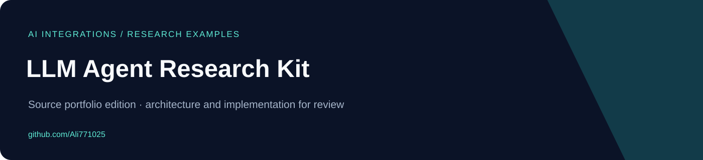
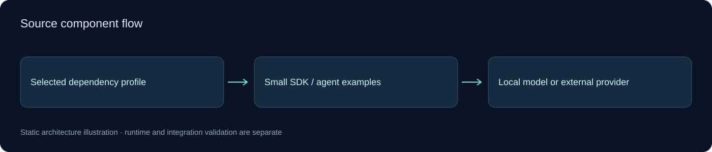

# LLM Agent Research Kit

<!-- project-contact:start -->
**Work with Yosof Omrani:** [Email a project inquiry](mailto:aliomrani916@gmail.com) · **aliomrani916@gmail.com** · [Services & contact](https://ali771025.github.io/software-portfolio/en/contact/) · [Portfolio walkthrough](https://ali771025.github.io/software-portfolio/en/#projects)
<!-- project-contact:end -->


**Small source-only LLM and agent integration research kit with provider examples and target-specific dependency profiles.**

[فارسی](docs/README.fa.md) · [Architecture](docs/ARCHITECTURE.md) · [Publication scope](docs/PUBLIC_EDITION.md)

## What the source contains

- Small provider/agent examples for different third-party SDK ecosystems.
- Separate dependency profiles to avoid mixing incompatible framework environments.
- Local-model and MCP-related example entry points without bundled runtimes.

## Start exploring

The profiles originated for standard CPython 3.13 on Windows x64. Select a profile and inspect its package requirements; model downloads and provider credentials are separate.

```bash
python -m venv .venv
# Activate the environment, then install the selected profile, for example:
python -m pip install -r profiles/01-openai.lock.txt
# Review examples/provider_chat.py and configure provider settings locally.
```

These commands are a setup reference, not a record of successful execution. No builds, tests, hardware sessions, provider requests or application runs were performed for this publication.

## Code entry points

- [`examples/provider_chat.py`](examples/provider_chat.py)
- [`examples/openai_agent.py`](examples/openai_agent.py)
- [`examples/mcp_server.py`](examples/mcp_server.py)
- [`SOURCES.md`](SOURCES.md)

## Architecture



See the [architecture guide](docs/ARCHITECTURE.md) for module boundaries and integration assumptions. Diagrams represent source structure; they are not screenshots or deployment evidence.

## Scope and current limits

The original archive contains roughly a gigabyte of third-party dependency packages; none are redistributed here. This is a research/integration example kit, not a new agent framework or a hosted service. Provider APIs, SDK compatibility and local model execution were not run for publication. Framework ownership and licenses remain with their publishers.

This compact public edition excludes previous Git history, real environment files, customer material, generated outputs and installed dependencies. Existing source/license notices are retained where present; no additional application license grant is invented.

## Work together

For a related workflow, custom application, integration or modernization project, [visit my GitHub profile](https://github.com/Ali771025) or [describe your project in an issue](https://github.com/Ali771025/llm-agent-research-kit/issues/new). Scope and deployment requirements can be discussed before implementation.
