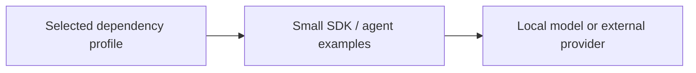

# Architecture — LLM Agent Research Kit

[Back to the project](../README.md)

## Responsibilities

- **Selected dependency profile:** Small provider/agent examples for different third-party SDK ecosystems.
- **Small SDK / agent examples:** Separate dependency profiles to avoid mixing incompatible framework environments.
- **Local model or external provider:** Local-model and MCP-related example entry points without bundled runtimes.

## Source boundaries

The original archive contains roughly a gigabyte of third-party dependency packages; none are redistributed here. This is a research/integration example kit, not a new agent framework or a hosted service. Provider APIs, SDK compatibility and local model execution were not run for publication. Framework ownership and licenses remain with their publishers.

## Review entry points

- [`examples/provider_chat.py`](../examples/provider_chat.py)
- [`examples/openai_agent.py`](../examples/openai_agent.py)
- [`examples/mcp_server.py`](../examples/mcp_server.py)
- [`SOURCES.md`](../SOURCES.md)

## Verification boundary

This document is based on a static reading of the source. No new tests or builds were performed. Integration prerequisites, permission behavior, external dependencies and real data quality require their own acceptance work before production use.
